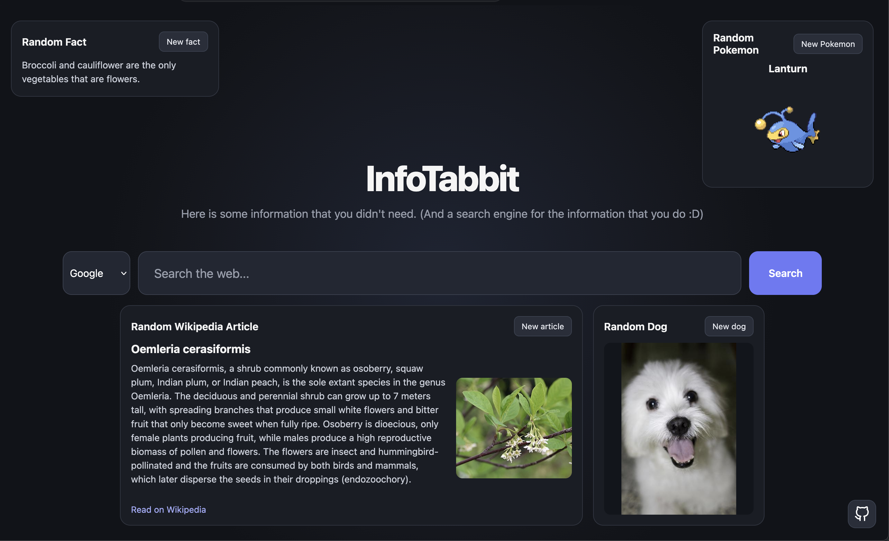

# InfoTabbit

InfoTabbit is a new tab page featuring some useful and mostly useless but interesting information. Since this is a new tab page it has a search function with multiple search engines.

## What it does

InfoTabbit lets you do your daily searching while giving you random and interesting information. It has:

- A Search Bar letting you search what you want using multiple search engines
- A random fact Card
- A random Pokemon Card
- A random Wikipedia Article Card
- And a random Dog Photo Card

## Search

The Search bar lets you use any of the provided search engines, those being Google, Duck Duck Go and Bing. The page locally stores your last pick so you don't need to manually change the search engine yourself!

Also you can enter links and the search bar will take you to than link instead of searching for that link!

## API

The project uses 4 api's but none of them require any api keys so you don't need to go and create your own.

## Stack

- **HTML** - for structure
- **CSS** - for styling
- **JavaScript** - for API, Search, Updating etc.

## AI Use

AI was used for CSS (I HATE CSS)

## License

This repository is licensed under the [MIT License](LICENSE)
